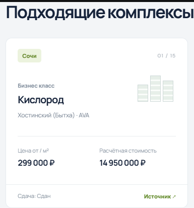
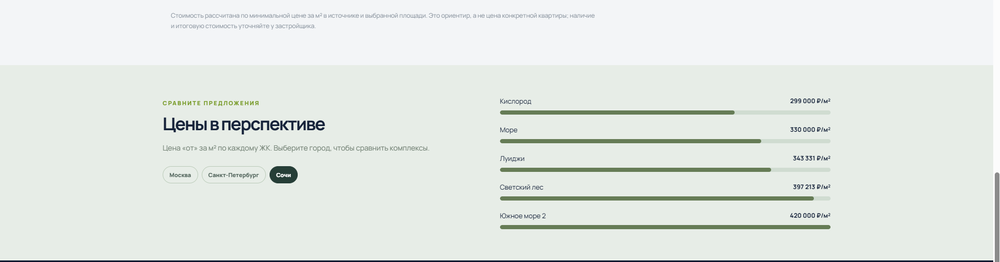
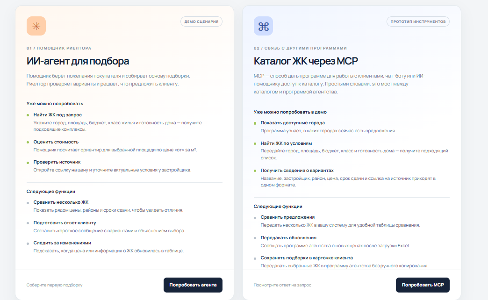
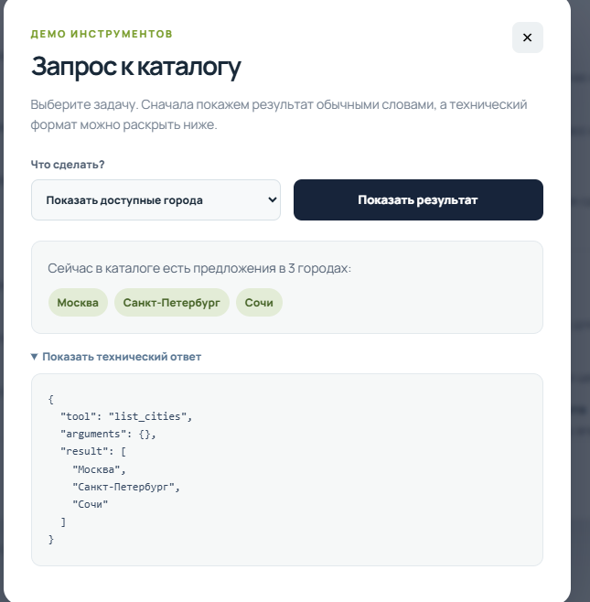

# Как устроен «Квадрат»

«Квадрат» помогает сравнить жилые комплексы по условиям покупателя. Данные берутся из Excel, сохраняются в PostgreSQL и показываются на сайте. Отдельная страница знакомит агентства недвижимости с идеями ИИ-помощника и подключения каталога через MCP.

## Что видит пользователь

### Главная страница

На первом экране находится поиск ЖК. Домик справа ведёт на страницу для агентств.


Пользователь выбирает город, площадь, предел цены за м² или общий бюджет. Дополнительно можно указать, сдан ли ЖК, и выбрать бизнес- или премиум-класс. Эти два фильтра необязательны.


Подходящие ЖК выводятся по возрастанию цены за м². В карточке видны район, застройщик, срок сдачи, источник цены и **расчётная** стоимость для выбранной площади.



Расчётная стоимость — это выбранная площадь × цена «от» за м². Она помогает сравнить варианты, но не подтверждает наличие конкретной квартиры по такой цене.

Ниже на странице есть сравнение цен за м². Можно переключать города и видеть цены всех ЖК выбранного города. На примере показан Сочи: подписи дают точную цену, а длина полосы помогает быстро сравнить комплексы внутри города.



### Страница для агентств

На странице `/agency` описаны два направления: ИИ-помощник риелтора и подключение каталога к другим программам через MCP. У каждого есть кнопка «Попробовать» и небольшое интерактивное окно.



## Идея ИИ-помощника

Риелтор задаёт пожелания клиента, а помощник собирает основу подборки. Это экономит время на первом поиске; проверка актуальной цены и решение, что отправить клиенту, остаются за риелтором.

**В демо сейчас:**

- поиск ЖК по городу, площади, бюджету, готовности и классу жилья;
- ориентировочный расчёт стоимости и короткий список вариантов;
- ссылки на источники цен.

В окне демо риелтор задаёт параметры клиента и получает короткий список. На примере для площади 50 м² и бюджета до 17 млн ₽ найдено два ЖК. Рядом с каждым показана ориентировочная стоимость и ссылка для проверки цены у застройщика.


**В планах:** сравнение нескольких ЖК по ключевым условиям, подготовка персонального сообщения клиенту и уведомления об изменениях в таблице. ИИ-модель сейчас не подключена: демо показывает сценарий подбора на данных каталога.

## Идея MCP для риелторов

MCP задуман как способ дать рабочей программе агентства или внешнему ИИ-помощнику доступ к сведениям о ЖК. Например, программа сможет запросить доступные города или найти комплексы под бюджет клиента, не копируя данные вручную с сайта.

**В демо сейчас:** можно запросить список городов и подобрать ЖК по условиям. Результат сначала показан обычными словами; технический ответ можно раскрыть отдельно.

На скриншоте выбран запрос «Показать доступные города». Сначала отображается понятный список из трёх городов. Ниже раскрыт технический ответ с теми же данными — он показывает формат, в котором программа могла бы получить результат.



**В планах:** передача обновлений цен, сравнение вариантов и сохранение подборки в карточке клиента. Полноценного MCP-сервера пока нет: демо использует существующий HTTP API и показывает, как могли бы выглядеть ответы будущих инструментов.

## Как движутся данные

Подробная схема импорта и общей архитектуры — в [architecture.md](architecture.md).

```text
Novostroyki_15_fin.xlsx
        ↓ импорт и проверка
PostgreSQL: таблица residential_complexes
        ↓ поиск через FastAPI
TypeScript-сайт: форма, карточки, график и демо для агентств
```

Скрипт импорта читает лист `ЖК`, а доступные ссылки и примеры цен — лист `Цены и источники`. При повторном запуске он обновляет запись по паре «город + название ЖК» или добавляет новую. Записи, исчезнувшие из Excel, автоматически не удаляются.

| Часть | Основные файлы | За что отвечает |
| --- | --- | --- |
| Правила предметной области | `backend/app/domain/complex.py` | Данные ЖК, параметры поиска, расчёт цены. |
| Сценарии | `backend/app/application/` | Поиск и импорт без привязки к HTTP или Excel. |
| Хранение и Excel | `backend/app/infrastructure/` | Чтение книги, SQL-запросы и подключение к БД. |
| HTTP API | `backend/app/api/routes.py` | Проверка параметров и маршруты `/api/cities`, `/api/complexes`. |
| Каталог | `frontend/src/page.ts`, `catalog-page.ts`, `cards.ts`, `chart.ts` | Форма, результаты и сравнение цен. |
| Для агентств | `frontend/src/agency-page.ts`, `agency-demo.ts` | Описание возможностей и интерактивные демо. |

Фронтенд отправляет запросы в FastAPI через Nginx. Изолированные зависимости Python закреплены в `backend/pyproject.toml` и `backend/uv.lock`. Команды запуска и обновления Excel находятся в [корневом README](../README.md).

## Что можно улучшить дальше

Сейчас каталог содержит 15 ЖК и цены «от» за м². Следующий этап — перейти от общего сравнения комплексов к подбору конкретных квартир и оценке района.

1. **Расширить данные о рынке.** Добавить предложения отдельных квартир и статистику вторичного рынка по городу и району. Сравнивать жильё похожей площади и класса, показывать среднюю и медианную цену за м², число предложений и дату обновления. Это поможет понять, как цена новостройки соотносится с местным рынком.
2. **Подключить объявления Авито и Циан.** Изучить доступные способы получения данных от площадок: API, партнёрский доступ или разрешённый сбор открытых объявлений. Показывать актуальные варианты квартир со ссылкой на объявление, убирать дубли и объявления, которые уже сняты с публикации. Перед реализацией нужно проверить условия использования данных каждой площадки.
3. **Показать удобства рядом с ЖК.** Добавить карту, ближайшие станции метро и остановки, школы, детские сады, поликлиники и парки. Для пользователя полезнее время пути пешком или на транспорте, чем расстояние по прямой.
4. **Ввести балл надёжности застройщика.** Рассчитывать понятную оценку, например от 0 до 100, по подтверждённым данным: сколько проектов сдано, были ли задержки, насколько открыта информация о сроках и проектах. Рядом с баллом показывать составляющие, источники и дату расчёта, чтобы оценка не выглядела произвольной.
5. **Улучшить подбор и работу агентства.** Добавить фильтры по числу комнат, ипотеке и удобствам района; сохранять подборки для клиента, сравнивать выбранные квартиры и сообщать об изменении цены. На этих данных можно развивать ИИ-помощника и инструменты MCP.

Практичный порядок работ: сначала собрать и регулярно обновлять данные по конкретным предложениям, затем добавить карту и сравнение с вторичным рынком, после этого — оценку застройщиков и персональные рекомендации. Все перечисленные возможности пока являются планом, а не функциями текущей версии.
