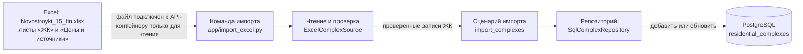
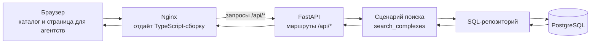

# Архитектура «Квадрата»

Проект состоит из Excel-файла с исходными данными, PostgreSQL, API на FastAPI и сайта на TypeScript. Docker Compose запускает базу, API и веб-сервер.

## Как Excel попадает в PostgreSQL



1. `docker-compose.yml` подключает Excel к контейнеру API по пути `/data/Novostroyki_15_fin.xlsx`. После готовности PostgreSQL контейнер запускает `python -m app.import_excel ...`.
2. [excel_source.py](../backend/app/infrastructure/excel_source.py) читает лист `ЖК` по названиям столбцов. Из листа `Цены и источники` он берёт доступные ссылки и примеры цен. До записи в БД проверяются обязательные поля и положительная цена.
3. [import_complexes.py](../backend/app/application/import_complexes.py) передаёт записи репозиторию. [sql_repository.py](../backend/app/infrastructure/sql_repository.py) сохраняет их одной транзакцией. Ключ совпадения — **город + название ЖК**: существующая запись обновляется, новая добавляется.

При повторном запуске импорт не создаёт дублей. Если ЖК исчез из Excel, его запись остаётся в базе: автоматического удаления нет. Таблица создаётся при первом запуске через SQLAlchemy `create_all`; миграции схемы БД пока не настроены.

Для повторного импорта обновлённого файла:

```powershell
docker compose run --rm api python -m app.import_excel /data/Novostroyki_15_fin.xlsx
```

## Как данные попадают на сайт



| Часть | Назначение |
| --- | --- |
| [domain/complex.py](../backend/app/domain/complex.py) | Данные ЖК, параметры поиска и формула ориентировочной стоимости. |
| [application/](../backend/app/application/) | Сценарии поиска и импорта; они не зависят от Excel или HTTP. |
| [infrastructure/](../backend/app/infrastructure/) | Чтение Excel, подключение к PostgreSQL и SQL-запросы. |
| [api/routes.py](../backend/app/api/routes.py) | Принимает фильтры и отдаёт города или подходящие ЖК. |
| [frontend/src/](../frontend/src/) | Показывает форму, карточки, график и демо для агентств. |

Сайт вызывает `GET /api/cities` и `GET /api/complexes`. Фильтры поиска выполняются в PostgreSQL; API рассчитывает ориентировочную стоимость как **площадь × цену «от» за м²** и отдаёт результат сайту. Демо на странице для агентств использует тот же API. ИИ-модель и MCP-сервер пока не подключены.
